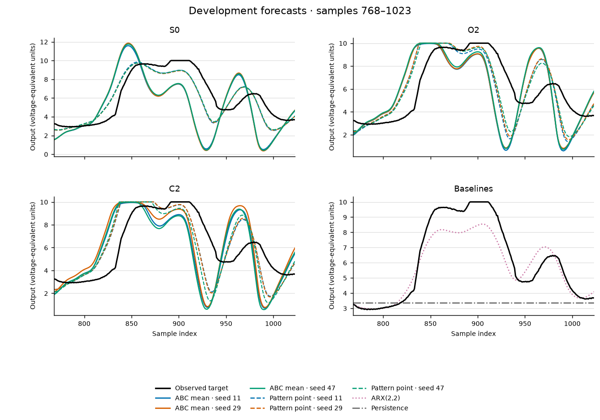

# Cascaded Tanks: seven-day methods result

As of October 21 UTC (October 20 in America/Los_Angeles).

The week produced a complete real-data prediction and cost comparison, with
independent metric replay. The simple ARX baseline predicted best. The three
surrogate families did not support a retained-state preference, and ABC did
not improve prediction at the matched simulator-call budgets used here.
The current configuration stops before refit and official evaluation.
The official record remains untouched.

This is a negative methods result on one rig. It is not a new physical law,
a calibrated posterior, an independent experimental replication, or evidence
that a local LLM improved discovery. Most executed work below was completed
on October 15; this October 21 report closes and consolidates that evidence.

## Prediction result

Training used estimation samples [0,768). All 20 arm forecasts were fixed and
reviewed before the single score on [768,1024). That suffix is now consumed
development data. It cannot serve again as untouched confirmation.

| Method | Development RMSE | Fitting simulator calls |
| --- | ---: | ---: |
| ARX(2,2) | 0.989970 | 0 |
| S0 point fit, median of three budget labels | 1.286612 | 2,537 total |
| C2 point fit, median of three budget labels | 1.948619 | 2,267 total |
| O2 point fit, median of three budget labels | 2.017705 | 2,434 total |
| C2 ABC weighted forecast, median of three inference seeds | 2.849383 | 2,267 total |
| O2 ABC weighted forecast, median of three inference seeds | 2.898543 | 2,434 total |
| S0 ABC weighted forecast, median of three inference seeds | 3.172464 | 2,537 total |
| Persistence | 3.790537 | 0 |

Call totals cover all three rows/seeds within each family/method, while errors
are medians of the three complete arms. ABC call totals include calibration.
Cheap baselines use no tank simulator fitting; zero simulator calls does not
mean zero computation. All nine point fits beat their matched ABC forecasts.
C2's ABC median is only about 1.7% below O2's, below the frozen 10% preference
margin. The paired difference also changes sign across seeds. Locked outcome:
unresolved. No family beat ARX. The original full table retains every arm.

See the [full development report](cascaded-tanks-week-development-results-2026-10-15.md)
for equations, split, all seed results, residuals, weights, parameter diagnostics,
failure handling and provenance. Independent replay matched every RMSE exactly,
maximum discrepancy zero. That was a recomputation of the consumed development
outcome, not a new physical experiment or another scoring attempt.

## What the follow-up checks establish

The point-search seed labels were different budget truncations of the same
deterministic path. They were not random optimizer replications. A new
training-only common-budget control ran 2,048 callbacks per family. S0/O2/C2
training RMSEs reached 0.855467/0.785439/0.786292, improving on each old longest
path by 5.84%/35.05%/38.07%. The full old prefixes match exactly. All three
final fits touch both the a lower bound and c upper bound. No new forecast
or target score follows from those lower training errors.

The stored ABC populations have valid finite distances, normalized supported
weights and matching ESS receipts, but remain far from the known point fits.
None of the nine has final weighted mass within 1.25 times the separate
common-budget point RMSE. That is a descriptive reference, not a matched-cost
comparison. The thresholds match the frozen q25/q10 calibration rule.
Generation 1 rejects 61.36–72.20% of proposals outside support; those consume
proposal attempts but no simulator calls. These observations motivate, but do
not settle, a smaller-tolerance control. They do not identify the cause of poor
forecasts or establish general inferiority of ABC.

The original research Qwen request hit its 768-token limit and failed JSON
validation. It was not retried and changed no candidate. A separate one-time
synthetic endpoint check used six generation calls and three counted GETs.
Both exact model IDs returned valid JSON on every call. Only one of six full
task answers passed the frozen semantic rubric; both models made arithmetic
or claim-restraint errors. Strata responded during the October 15 check; it did not respond to the
October 21 GET checks. No research-model
upgrade or general model ranking is established. Valid JSON did not establish
scientific correctness. No generated code was executed.

## Costs, checks and limits

Original fitting used 14,476 simulator calls: 2,304 calibration, 4,934 ABC and
7,238 point callbacks. The common-budget training control adds 6,144 calls.
Total fitting: 20,620. Original forecasting used 585 simulator replays and
599,040 steps. No additional forecast or official score was made afterward.
The two child-reported numerical stages total 38.735304 seconds, including
baselines and original forecasts. Their supervisor elapsed times total about
39.616584 seconds. Neither figure measures total human, agent, engineering
or review time. The original stage's peak sampled worker-tree
RSS was 68,304,896 bytes; the training control's was 52,084,736 bytes.
Sampling does not prove a continuous memory maximum.

No new research data was acquired. The existing 7,520,592-byte archive is bound
by SHA-256 in the source manifest. Raw arrays stay local and ignored; compact
receipts, independent replays, plots and source/configuration are published.
The development source content is commit
`5997cc2c0498b3ff435499c049fb5976f4b2f1e2`. The two new product runtime files
were 994 lines total, with 299 focused test lines. The independent source
review reported 12 passing synthetic tests in the current tree and a clean
source overlay. Those tests alone are not the scientific evidence.

One monitor limitation remains explicit: the common-budget control's final
progress combination failed its monitor validator. The monitor charged the
full 6,144-call cap; the terminal and arrays independently confirm exactly
6,144 calls. There was no external stop or retry. Do not rerun merely to clear
that flag. The old B2a patch and ABC6 launch framework remain deferred.
The canonical legacy evaluator was not repaired by this narrow study.

The one rig, one development block, fixed support, fixed initial lower state
and ceiling, finite tolerances, and lack of independent conditions restrict
all claims. Descriptive particle spread is not calibrated uncertainty. There
is no model probability, causal mechanism identification, or breakthrough.

## Decision and remaining question

The prediction/cost deliverable is complete. The current v1 configuration
stays stopped before refit and one-use official evaluation. This is primary
scientific prioritization based on development evidence; it is not a new
prespecified eligibility test or a software failure. Preserve the unused
official record for a scientifically justified, separately frozen study.

Primary cuts the optional tighter-tolerance S0 control for this week. The
scientific design passed independent review, but the author found no readable
80-line existing-API command that keeps the required prefix, failure, cost,
pin and output-size checks. The existing wrapper fixes two populations; the
generic reference can accept a third, but a safe one-off invocation needs
more control paths. No command was written, no run directory was created,
and no fit ran. This is an operational scope cut, not an observed inference
failure or evidence that a tighter tolerance cannot help. It spends zero
simulator calls. Do not expand the wrapper or rebuild orchestration to avoid
this decision. The unexecuted [control protocol](cascaded-tanks-s0-epsilon-control-protocol-2026-10-21.md)
is preserved as design history; its design GO was never a launch GO.

The seven-day methods study is now closed with its negative result and limits.
The wider discovery project remains open. Next, primary should choose one new
question that can gain independent evidence. First assess whether accessible
non-official records can distinguish the competing tank mechanisms under a
credible measurement model. A single rig's consumed suffix cannot supply that
independence. If no suitable conditions exist, choose one other free domain
with independent experimental units and a clear measurement model. Bound that
choice to one wake; do not open another general infrastructure project. Freeze
the question, explicit competing mechanisms, cheap controls, evaluation units,
splits, budget and stop rule before fitting. Keep local proposals plus checked
ABC-SMC inference, and verify any scientific claim analytically or numerically.

Evidence index:

- [Development protocol](cascaded-tanks-week-development-v1-protocol-2026-10-15.md) and [independent metric replay](cascaded-tanks-week-development-evidence-2026-10-15/independent-metric-replay.json).
- [Point receipt audit](cascaded-tanks-training-receipt-audit-results-2026-10-15.md) and [common-budget control](cascaded-tanks-training-budget-control-results-2026-10-15.md).
- [ABC tolerance audit](cascaded-tanks-abc-training-receipt-audit-results-2026-10-15.md) and [independent replay](cascaded-tanks-abc-training-receipt-audit-evidence-2026-10-15/independent-replay.json).
- [Local-model check](local-qwen-fixed-task-acceptance-results-2026-10-15.md) and [independent semantic assessment](local-qwen-fixed-task-acceptance-evidence-2026-10-15/independent-assessment.json).
- [October 15 ledger](research-ledger/2026-10-15T1908Z.md) and [week-close ledger](research-ledger/2026-10-21T0414Z.md).
