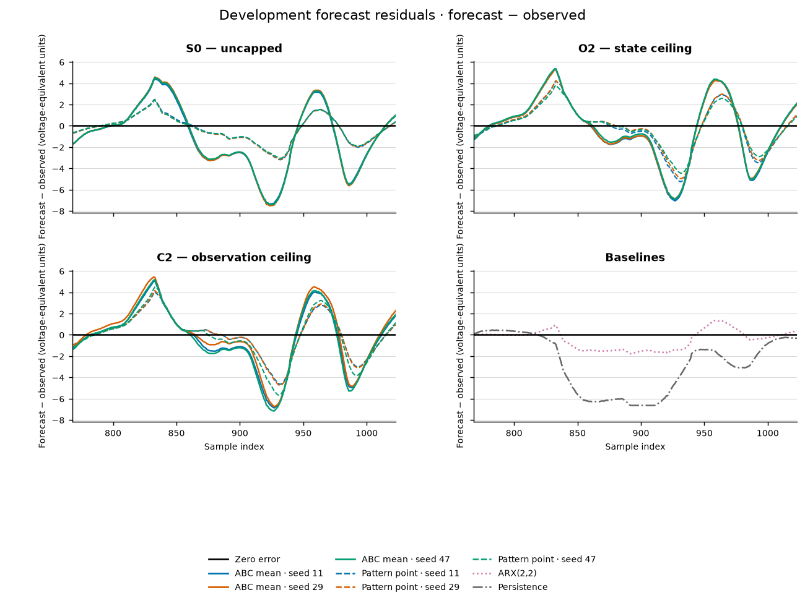

# Cascaded Tanks: development prediction and cost

Independently reviewed result. The forecast review cleared all 20 arms
before the single development score. Independent metric replay reproduced
all 20 RMSEs exactly, with maximum absolute discrepancy zero.
Run: `ct-memory-week-dev-20261015-v1`.

All 20 declared arms completed. The locked outcome is **unresolved** under
the predeclared 10% model margin. ARX has the lowest development RMSE, 0.990;
the best ABC family median is C2 at 2.849. Matched point search outperformed
ABC in all nine pairs. The development-fit stage, including baselines and forecasting,
took 28.090 seconds and used 14,476 fitting simulator calls.
All candidate families and budgets were fixed before target access.

## Development results

Errors below cover all 256 estimation-suffix points. They are voltage-equivalent
output RMSE, rounded to six decimals. Every arm completed; none was excluded.
The last column counts fitting simulator callbacks. ABC counts include its
256 calibration calls; each point arm uses exactly that paired allowance.
ARX and persistence have no tank-simulator fit calls and are cheap references.

| Family | Seed | ABC RMSE | Point-search RMSE | Fit calls per arm |
| --- | ---: | ---: | ---: | ---: |
| C2 | 11 | 2.814419 | 1.901892 | 831 |
| C2 | 29 | 2.849383 | 1.948619 | 799 |
| C2 | 47 | 2.946826 | 2.248759 | 637 |
| O2 | 11 | 2.934253 | 2.090029 | 735 |
| O2 | 29 | 2.882395 | 2.017705 | 765 |
| O2 | 47 | 2.898543 | 1.818822 | 934 |
| S0 | 11 | 3.151399 | 1.307131 | 815 |
| S0 | 29 | 3.223451 | 1.286612 | 841 |
| S0 | 47 | 3.172464 | 1.260149 | 881 |

| Cheap baseline | RMSE | Tank-simulator fit calls |
| --- | ---: | ---: |
| ARX(2,2) | 0.989970 | 0 |
| Persistence | 3.790537 | 0 |

ABC family medians are C2 2.849383, O2 2.898543 and S0 3.172464. C2's
median is only about 1.7% below O2's, so it fails the frozen 10% preference
margin. C2 minus O2 RMSE by seed is -0.119835, -0.033012 and +0.048283;
the direction is not uniform. All three families are eligible, so this is an
unresolved comparison rather than a failure-driven exclusion.

Point-search family medians are C2 1.948619, O2 2.017705 and S0 1.286612.
The family ordering changes with fitting method. Neither the ABC means nor
any point fit beats ARX here. These observations do not support promoting
the retained-state hypothesis or claiming ABC improves prediction per call
under this fixed discrepancy, prior and tolerance schedule. They do not show
that ABC is generally inferior, or that ARX identifies the true dynamics.

The replay also computed descriptive MAE; ARX is 0.771562 and persistence
2.878011. All arm-level MAEs are in the compact replay record. MAE was not
part of the selection rule and did not change the locked outcome.

## Particle diagnostics

The table reports final-population ESS by seed and the median across seeds
of each weighted parameter standard deviation. It does not pool inference
seeds into independent observations or claim calibrated uncertainty.

| Family | ESS for seeds 11 / 29 / 47 | Weighted SD of `(a,c,p,x1_0)`, median across seeds |
| --- | --- | --- |
| C2 | 55.852 / 51.901 / 56.685 | (0.314, 0.372, 0.298, 7.552) |
| O2 | 56.246 / 36.126 / 48.613 | (0.329, 0.391, 0.310, 7.262) |
| S0 | 50.248 / 58.916 / 57.052 | (0.328, 0.349, 0.257, 6.752) |

Median weighted c:p correlations are 0.704, 0.722 and 0.561 for C2/O2/S0.
The clouds remain broad and contain parameter tradeoffs. ESS alone does not
show accurate forecasts, calibrated uncertainty or identified mechanisms.
The compact replay record retains all six parameter-pair correlations.
The fixed prior and finite tolerances limit what these diagnostics mean.

A post-score, read-only check of saved **training** receipts found two useful
warnings. Each point fit's training RMSE is below every final ABC particle's
stored training RMSE in its matched pair. Final epsilon ranges are C2
2.407–2.546, O2 2.396–2.480 and S0 2.897–2.936. The finite-tolerance clouds
include many poorer training fits; this is a possible contributor to their
prediction gap, not a controlled causal explanation. Also, every point fit
ends at the `c=1.5` upper support boundary, with no other coordinate exactly
on a boundary. The frozen box may constrain useful fits. Neither observation
licenses changing the current prior or tolerance after its score.

## Forecasts and residuals

All three seeds are shown. Solid colored lines are ABC weighted means;
dashed lines are paired point fits. The fourth panel shows both cheap
baselines. Black is the observed development target; residual is forecast
minus observed. No seed was selected from its target error. The figures show
means/point forecasts; weighted particle bands remain in the raw evidence.

Plotting used a separate ignored environment: Python 3.12.11, matplotlib
3.11.2 and NumPy 2.5.4. It did not change the fit environment or rerun fitting
or scoring. Both figures together are about 0.4 MB. Plot provenance binds
the consumed target, manifest, receipt and forecast hashes.

## Question and models

The question is whether a surrogate that retains hidden state behind an
observation ceiling (C2) predicts recovery better than one that discards state
at the ceiling (O2). S0 is the uncapped alternative. The data come from one
rig. Three inference seeds describe compute variation, not three experiments.
This is a development comparison, not independent confirmation or discovery.

For nonnegative states, the common per-sample updates are

\[
x_{1,k+1}=\max(0,x_{1,k}+p u_k-a\sqrt{x_{1,k}}),\qquad
z_{2,k+1}=\max(0,x_{2,k}+\sqrt{x_{1,k}}-c\sqrt{x_{2,k}}).
\]

S0 uses `x2[k+1]=z2[k+1]`, `y[k]=x2[k]`. O2 uses
`x2[k+1]=min(H,z2[k+1])`, `y[k]=x2[k]`. C2 uses
`x2[k+1]=z2[k+1]`, `y[k]=min(H,x2[k])`. Observation precedes the update.
The lower inflow coefficient is fixed at one by the latent-scale convention.
Samples are four seconds apart; coefficients operate per sample, without a
further time multiplier. They are not identified physical flow constants.

Fit `(a,c,p,x1_0)` within `[0.2,1.5]`, `[0.2,1.5]`, `[0.05,1.2]`, `[0,25]`.
Fix `x2_0=5.205` and, for O2/C2, `H=10`. These training-conditioned choices
restrict uncertainty. Neither an overflow mechanism nor a sensor mechanism
can be established from this surrogate comparison.

## Frozen method and split

Training uses estimation indices `[0,768)`. Each forecast carries its fitted
latent state through that training prefix, then predicts `[768,1024)` using
only the later inputs. Development targets stay hidden until every arm's
forecast/failure is frozen and independently reviewed. Official inputs and
outputs are excluded from this release; refitting needs a separate stage.
The [official benchmark description](https://www.nonlinearbenchmark.org/benchmarks/cascaded-tanks)
provides the dataset citation and separate estimation/test records. These
development errors are not a leaderboard submission or official test result.

Each family has ABC seeds 11, 29 and 47. Each fit uses 256 prior calibration
draws, linear q25/q10 thresholds, and the checked Gaussian ABC-SMC reference:
two populations of 64 particles, at most 8,192 proposals per population,
covariance scale 2, noise fraction 0.01 and nugget `1e-9`. Out-of-support
proposals are rejected, not clipped. Failed simulations count as calls and
have infinite distance. Both populations, weights and diagnostics are kept.
These particles do not establish a calibrated posterior or model probability.

Each paired pattern search receives its ABC arm's actual calibration plus
simulation-call allowance. It uses the existing normalized-cube center/corner
search, mesh 0.25 to `2**-10`. ARX(2,2) uses fixed ordinary least squares and
free-run initialization from the last two measured training outputs. A pole
with magnitude at least one fails the arm; no repair is allowed. Persistence
uses the last measured output. These cheap baselines are reported separately.

ABC predictions use every final particle and its normalized weight. One
failed particle fails the arm. Weighted 10/90% bands describe parameter spread;
they are not calibrated prediction intervals. No failed particle is dropped.

Selection uses median seed RMSE only for ABC families complete under all
three seeds. Fewer than two eligible families means unresolved. A preferred
family must improve by at least 10% over each other eligible family; useful
prediction also requires that margin over both cheap baselines. This is an
engineering rule, not a significance test. Failed families cannot be beaten
by omission. No target-driven changes are permitted.

## Cost and failures

Fitting used 2,304 calibration calls, 4,934 ABC callbacks and 7,238 matched
pattern callbacks. All 18 ABC populations completed with zero failed
simulations. The second populations rejected 4,991 out-of-support proposals;
those proposals do not count as simulator calls. Pattern callbacks had no
failures. Each pattern arm used its paired allowance.

Forecasting used 585 simulator replays and 599,040 steps: 576 particle replays
and nine point replays. The runner-reported development-fit stage, including
baselines and forecasts, took 28.090 seconds; the external supervisor
observed 28.438 seconds, exit 0 and no resource stop. Peak sampled worker-tree
RSS was 68,304,896 bytes, about 65.1 MiB. Peak run files were 2,260,661 bytes.
One-second sampling does not prove an unsampled memory maximum. The limits
were 299,520 fit calls, 60 minutes, 4 GiB sampled RSS and 1 GiB artifacts;
forecast limits were 600 calls and 120 seconds. One worker ran with BLAS
thread variables set to one. No data acquisition was needed.

The single original-Qwen request returned HTTP 200 and the exact requested
model but hit its 768-token limit and failed JSON validation. It used 372
prompt tokens and 768 completion tokens. No retry or generated code was used.
It did not change the candidates. This study does not show an LLM benefit.
Strata received no generation or lifecycle request for this comparison.

## Reproducibility and limits

Code content commit: `5997cc2c0498b3ff435499c049fb5976f4b2f1e2`.
Fit runtime: Python 3.14.3 and NumPy 2.4.2; monitor psutil 7.2.2.
Manifest SHA-256:
`1981072a7557a87bba893fb1f71ae7f051bcad40f5651b70b80821229f6de029`.
Target-free forecast bundle SHA-256:
`e0a1ea9fc804539870a27e65bb38564a065a975f1976ea6535a66d39c979a625`.
The existing archive is 7,520,592 bytes, SHA-256
`eb0fa05851e8a7136846c2e3b61fbef87def78d0852c86ab91b02ac5db541b51`.

The independent code review passed 12/12 synthetic tests in the working tree
and a clean-HEAD overlay. It first found real forecast-clock, checkpoint,
resource-stop and failed-distance defects. Their corrections and negative
evidence remain in the ledger. Passing those tests did not itself establish
a scientific result. The old ABC6 campaign and its unreviewed B2a edit remain
deferred; this study does not depend on them. Silverbox's consumed condition
has not been reopened.

Local raw evidence lives under
`artifacts/cascaded-tanks-week/ct-memory-week-dev-20261015-v1/` and stays out
of Git. See the frozen development protocol and the 09:07Z/09:41Z ledgers.

Compact public evidence contains no target sequence or particle draws:
[manifest](cascaded-tanks-week-development-evidence-2026-10-15/manifest.json),
[score receipt](cascaded-tanks-week-development-evidence-2026-10-15/score-receipt.json),
and [independent metric replay](cascaded-tanks-week-development-evidence-2026-10-15/independent-metric-replay.json).
The [development protocol](cascaded-tanks-week-development-v1-protocol-2026-10-15.md)
defines the exact random streams, budgets, failure rules and stage reviews.
The [runner](../scripts/run_cascaded_tanks_week.py) exposes `freeze`,
`fit-development` and `score-development` through
`python3 -m scripts.run_cascaded_tanks_week`. Reproduction needs a clean
checkout at the content commit, the exact archive/runtime, and the same
separate fit/forecast/score reviews. Preserve this completed run and its marker.

The single score completed at 2026-10-15T09:54:56Z. Target-suffix vector SHA-256 is
`0978c68c223206fd1e9df2608cc690f4247f0d80ccfb420b2620165cc750a545`;
score receipt file SHA-256 is
`ed1eecb7e1e0c0fde24a03df654eeebf34153c0c3636fcd113980c33ad5dc2e6`.
Independent replay record SHA-256 is
`306509feb9a3ddfbbd3c9409f97dbf8b87763b8ae79c1c4652d67db38bbac4ca`.
Replay reopened only the consumed development suffix. It did not rerun the
score, change its marker, refit models or access official fields.

## Decision

The study now has a complete, independently checked real-data comparison.
It has no positive evidence for the retained-state preference and no measured
ABC prediction advantage at these settings. Keep the locked outcome
unresolved. Preserve every arm and the official test. Do not change this run
or use another score attempt to improve its story.

Next, assess the support-boundary and tolerance warnings using training-only
evidence before spending on another fit. Any new tolerance or model choice needs a new
development protocol, not a rewrite of these results. Refit and official
scoring remain a separately reviewed scope. Broad domain expansion and ABC6
runtime work stay deferred. This result is methods evidence, not a scientific
breakthrough or an independent physical replication.
